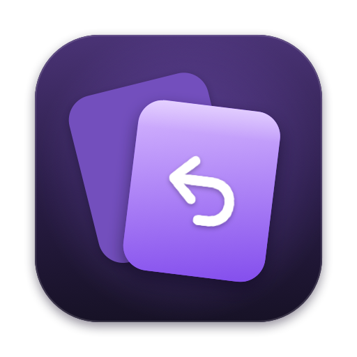
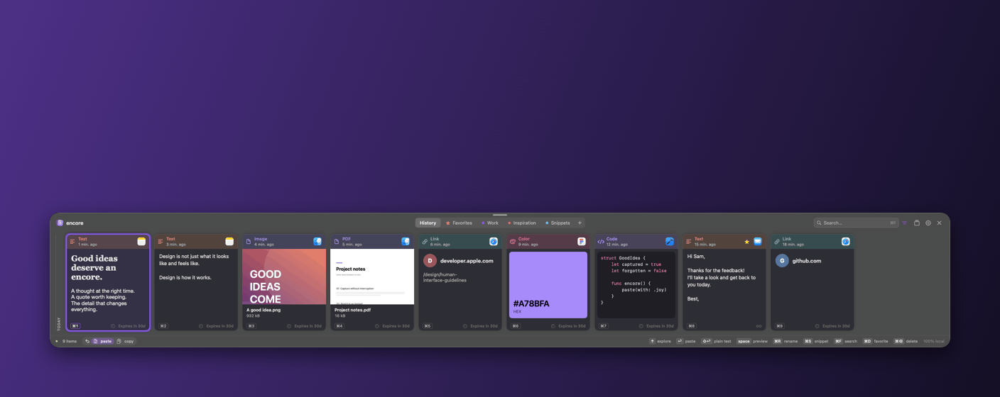
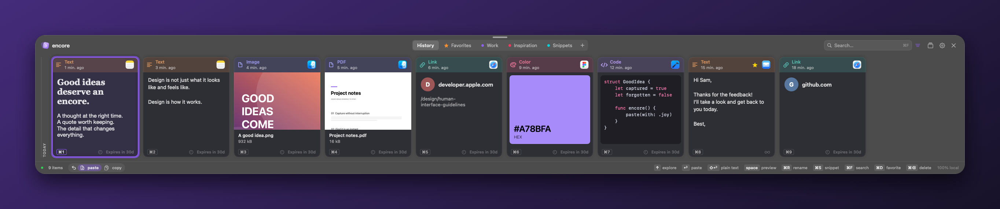
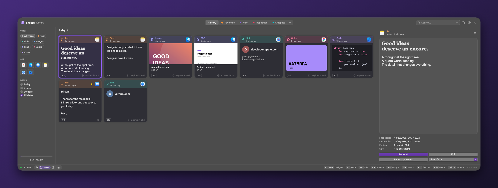

<p align="center"></p>
<h1 align="center">encore</h1>
<p align="center"><strong>Your clipboard. Yours to keep.</strong></p>
<p align="center">A native clipboard manager for macOS. Free, open source, and local.<br>No account, no subscription, no cloud.</p>
<p align="center"><a href="https://github.com/Kamasoutra/encore/releases/latest/download/Encore-macOS.zip"><strong>Download for Mac ↓</strong></a> · <a href="https://kamasoutra.github.io/encore/">Website</a> · <a href="https://github.com/Kamasoutra/encore/releases">Releases</a></p>
<p align="center">macOS 12+ · Apple Silicon & Intel · 30 languages · MIT</p>

<p align="center"><code>brew install --cask kamasoutra/tap/encore</code></p>



You copy all day. encore remembers it, so you can stop copying the same things twice. Press **⇧⌘V** wherever you type, pick a card, press **Return**: it is pasted right there. No window to manage, no app to switch to.

## A shelf at your fingertips



Your latest copies sit in a shelf at the bottom of the screen, newest first. Each card shows what it holds at a glance: the text itself, the image, the page of a PDF, the color swatch, the code with its highlighting, and the app it came from. Arrows to move, Return to paste, ⇧Return for plain text, ⌘1–9 for the first nine. Press **Space** to preview a card in full size without leaving the shelf.

## A library when you need to dig



Press **↑** and the shelf grows into a full library: every copy grouped by day, filters by type, app and date, and a large preview with when it was first and last copied. Just start typing to search, including the text inside your images, recognized on your Mac. Hold **↓** to come back.

## Built to keep only what matters

- **Favorites and collections** keep snippets, addresses and templates forever, and you can drag cards into them.
- **Retention rules** by size and type clean up the heavy stuff on their own. Every card tells you how long it stays.
- **Exclusions** keep password managers out, and content that apps mark as confidential is skipped.
- **A paste queue** pastes several items in order, one ⌘V at a time.

## Your other Macs, without a cloud

Pair two Macs on the same network with a 6-digit code, and each one appears as a tab in the shelf. Browse the other Mac's recent copies and paste them as if they were yours. The connection is end-to-end encrypted, keys stay on each Mac, and there is no server or account involved.

## Native, down to the details

Built with SwiftUI and AppKit, not a web view. Light and dark appearances, 30 languages including right-to-left ones, a menu bar icon, quiet sound sets you can preview in one click, and signed updates straight from GitHub releases.

## Install

**With Homebrew**

```sh
brew install --cask kamasoutra/tap/encore
```

**Or by hand:** [download the ZIP](https://github.com/Kamasoutra/encore/releases/latest/download/Encore-macOS.zip), unzip it, and move **Encore.app** to **Applications**.

Then:

1. Open encore. It is not notarized yet: if macOS blocks the first launch, follow [Apple's Open Anyway steps](https://support.apple.com/en-us/102445).
2. Allow it in **System Settings → Privacy & Security → Accessibility** so Return pastes directly. Without it, encore copies the item and you press ⌘V, and the shelf shows a warning until access is granted.

Quit any other clipboard app that uses ⇧⌘V. encore also lives in the menu bar and answers to **⌃⌥⌘V**. Requires macOS 12 or later, on Apple Silicon or Intel. Each release includes a SHA-256 checksum.

## Keyboard

| Action | Shortcut |
| --- | --- |
| Show / hide | ⇧⌘V |
| Library | ↑ from the shelf |
| Back to the shelf | Hold ↓ in the library |
| Move / extend selection | Arrows / ⇧ + arrows |
| Paste / plain text | Return / ⇧Return |
| Quick paste | ⌘1–9, including AZERTY |
| Search / preview | ⌘F or type / Space |
| Switch board | ⌘← / ⌘→ |
| Favorite / settings | ⌘D / ⌘, |
| Delete / undo | Delete / ⌘Z |
| Card size | ⌘+ / ⌘− |

Search understands `app:safari type:link`, `date:today`, `date:7d`, `date:30d`, and `after:2026-10-01 before:2026-11-01`. The optional global queue shortcut ⇧⌘C is off by default.

## Keep the useful things

Retention rules are evaluated from top to bottom, and the first match wins. The presets use explicit ranges:

| Content size | Retention |
| --- | --- |
| 3 GB and above | 1 hour |
| 500 MB to less than 3 GB | 2 days |
| 300 MB to less than 500 MB | 1 week |
| Text below 1 MB | Forever |
| Everything else | Your default duration |

Copying an item again renews its expiry. Favorites and collection items stay indefinitely. Changes are previewed before you apply them.

Files are referenced rather than copied into encore, so a multi-gigabyte file uses little storage. Moving or deleting the original can make an entry unavailable. Embedded clipboard data is limited to **25 MiB per copy**.

## Your data

History lives in `~/Library/Application Support/Encore/` and never leaves your Mac unless you turn on sharing. There is no account, telemetry, or remote link preview. Storage and exported backups are **unencrypted** and restricted to your macOS account.

encore makes two kinds of network requests, both optional:

- **Updates.** encore checks GitHub for a new release, and installs it only if it is signed with the project's key. You can turn this off in Settings.
- **Other Macs.** Off until you enable it. Macs find each other on the local network with Bonjour and pair with a 6-digit code. Traffic is end-to-end encrypted, and the keys stay on each Mac in a file only your account can read, next to the history.

Defaults are 30 days, 2,000 unprotected items, and a 500 MiB content budget. Password-manager exclusions depend on installed apps. Confidential clipboard markers are honored, but not every app sets them. Screenshot import is off by default.

## Development

Building needs Swift 5.10+ (Xcode 15.3+); the app itself runs on macOS 12+. The only dependency is [Sparkle](https://sparkle-project.org) for updates.

```sh
git clone https://github.com/Kamasoutra/encore.git
cd encore
swift test
bash scripts/build.sh
open dist/Encore.app
```

Use `open -n dist/Encore.app --args --demo` for a separate, synthetic library. Quit the normal instance first. Without the release certificate, the build script signs ad hoc.

encore is independently implemented and includes no code or assets from other clipboard apps. The default sound sets are synthesized by `scripts/sounds.py`. The Soft, Crisp and Wood sets are adapted from [Kenney's Interface Sounds](https://kenney.nl/assets/interface-sounds), released under CC0.

[Contributing](CONTRIBUTING.md) · [Security](SECURITY.md) · [MIT license](LICENSE)
