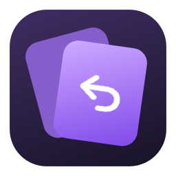
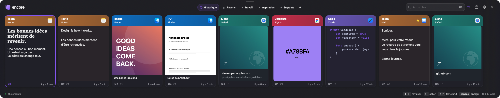
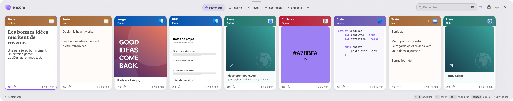
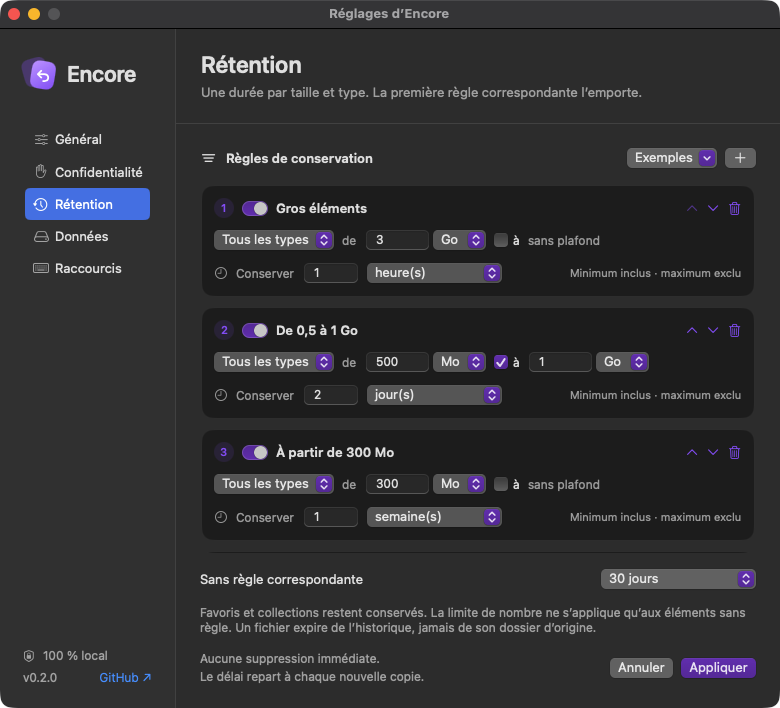
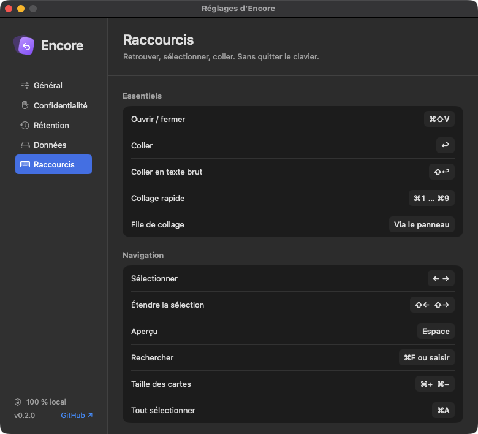

<p align="center">
  
</p>
<h1 align="center">Encore</h1>
<p align="center"><strong>Your clipboard. Yours to keep.</strong></p>
<p align="center">A native clipboard shelf for macOS. Local, open source, and subscription-free.</p>
<p align="center">
  <a href="https://github.com/Kamasoutra/encore/releases/download/v0.2.0/Encore-0.2.0-macOS-arm64.zip"><strong>Download for Apple Silicon ↓</strong></a>
  · <a href="https://github.com/Kamasoutra/encore/releases/tag/v0.2.0">Release notes</a>
  · <a href="docs/FEATURES.md">Feature status</a>
</p>
<p align="center">macOS 14+ · SwiftUI + AppKit · MIT · French interface</p>



Press **⇧⌘V**, find a card, and press **Return**. Keep what matters, let the rest expire, and get back to your work. No account, telemetry, or runtime dependencies.

<details>
<summary>Light mode and native settings</summary>



<p>
  
  
</p>

</details>

## Install

1. [Download the ZIP](https://github.com/Kamasoutra/encore/releases/download/v0.2.0/Encore-0.2.0-macOS-arm64.zip), unzip it, and move **Encore.app** to Applications.
2. Launch Encore. This early build is **ad-hoc signed, not Apple-notarized**. If macOS blocks it, follow [Apple's per-app Open Anyway instructions](https://support.apple.com/en-us/102445) in System Settings → Privacy & Security, after checking the release and its checksum.
3. Quit any app already using ⇧⌘V, then copy something. The menu-bar icon also opens Encore; **⌃⌥⌘V** is the fallback shortcut.
4. Enable Encore in **System Settings → Privacy & Security → Accessibility** for direct paste at the cursor and sequential paste. Without permission, Encore copies the selection for you to paste with ⌘V.

**Pre-release 0.2.0:** Apple Silicon binary; Intel downloads and Homebrew installation are planned. Updates are manual. Replacing an ad-hoc build may require granting Accessibility again. See [what has actually been validated](docs/VALIDATION.md).

## A visual memory for your clipboard

- **Native previews.** Images, PDFs and other supported documents get Quick Look thumbnails, including files copied from Finder. Rich text keeps its formatting in the card. Links use a local preview without visiting the site.
- **A shelf that fits.** Resize its height, zoom cards with ⌘+ / ⌘−, choose light/dark/system appearance, and place it on the current, primary, or a specific display.
- **Keyboard first.** Arrows, quick paste with ⌘1–9 (including AZERTY), plain-text paste, multiple selection, and a resizable preview/editor.
- **Find and organize.** Search content, app, type, dates, and locally recognized image text. Keep favorites and collections; one item can belong to several collections.
- **Keep the original.** Retain rich pasteboard representations and multiple files. Collect a temporary FIFO queue and paste items one by one with ⌘V.
- **Make it yours.** Sounds for capture and paste, three built-in sound pairs, volume, and custom audio files. Optional import of newly saved native screenshots.
- **Stay in control.** Capture pause, app exclusions with names and icons, local OCR, JSON backup/import, deletion undo, and non-destructive text transformations.

## Retention with finer control

A large file reference should not have to live as long as a short note. Create **ordered rules by content type and size**, with durations in minutes, hours, days, weeks, months, or forever.

| Example rule, in priority order | Keep for |
| --- | --- |
| At least 3 GB | 1 hour |
| 500 MB to less than 1 GB | 2 days |
| At least 300 MB | 1 week |
| Plain text below 1 MB | Forever |

The **first matching rule wins**. Settings can load these examples as a draft; nothing is removed until you apply. Preview the impact before confirming removals.

Every item retains its first and most recent copy times. Recopying renews expiry. Favorites and collection items stay indefinitely; items matched by a rule bypass the generic item-count limit. Unmatched items use the fallback duration.

For files, rules use the referenced files' size without copying their contents. A 3 GB file reference is supported; a **3 GB embedded clipboard payload is not**. Embedded content is limited to **25 MiB per copy**. Retention thresholds use decimal MB/GB; the content budget uses binary MiB/GiB. Unknown file sizes fall back to the default policy.

## Keyboard

| Action | Shortcut |
| --- | --- |
| Show / hide | ⇧⌘V (or ⌥⌘V in Settings) |
| Emergency show / hide | ⌃⌥⌘V |
| Start / stop sequential queue | ⇧⌘C globally, when enabled |
| Navigate / extend selection | ← → / ⇧← ⇧→ |
| Dismiss from cards / keep selection | ↓ / ↑ |
| Paste / plain text | Return / ⇧Return |
| Quick paste | ⌘1–9 on the number row; add ⇧ for plain text |
| Preview / edit | Space / ⌘E |
| Search | Type, or ⌘F |
| Move focus between search and cards | Tab |
| Favorite | ⌘D |
| Add selection to queue | ⇧⌘Return |
| New text / collection | ⌘N / ⇧⌘N |
| Select all / copy selection | ⌘A / ⌘C |
| Delete / undo deletion | Delete / ⌘Z |
| Next / previous collection | ⌘→ / ⌘← |
| Zoom cards | ⌘+ / ⌘− |
| Pause capture / settings | ⌘T / ⌘, |
| Clear search, then dismiss | Escape |

Search examples: `app:safari type:link`, `type:image invoice`, `date:today`, `after:2026-10-01 before:2026-11-01`. Dates use your Mac's time zone; `before:` excludes that day. The optional global queue shortcut reserves ⇧⌘C and is off by default; a fully configurable shortcut recorder is planned.

## Data and privacy

- No networking, analytics, third-party SDKs, or remote link previews in the app.
- Library: `~/Library/Application Support/Encore/`. Preferences: UserDefaults under `local.kama.Encore`.
- Content and JSON exports are **unencrypted**. Directories are owner-only (0700), files owner-only (0600). This does not isolate your clipboard from other processes running as you.
- Files are references. Moving/deleting originals can break those entries; exports do not include the original files.
- Defaults: 30 days, 2,000 unprotected/unmatched items, and 500 MiB of raw embedded content. Encoding, metadata, OCR, and recovery files add disk overhead. A full budget **refuses new copies with a notice**, preserving existing retained items.
- An automatic previous-index backup helps recover a damaged `Library.json`; the damaged file is preserved in `Recovery/`. This is not a complete versioned backup of payloads or referenced files. Export regularly if history matters to you.
- The first launch starts with the **next** copy. Password-manager apps and confidential/transient pasteboard markers are excluded by default; not every app or browser extension supplies those markers.
- Saved screenshot import is **off by default**. When enabled, it watches new macOS screenshot metadata in a folder you select while Encore is running. It relies on Spotlight indexing; it does not scan your screen or replace the current clipboard.
- The sequential queue's event tap exists only while the queue is active and does not log keystrokes. Synthetic paste events bypass it.

Changing exclusions does not delete earlier entries. Clearing history preserves favorites/collections and asks for confirmation. Deleting a collection keeps its contents in history.

## Build and contribute

No compilation is needed to use the download above. For development, install Xcode with Swift 5.10+ and select its command-line tools:

```sh
git clone https://github.com/Kamasoutra/encore.git
cd encore
swift test
bash scripts/build.sh
open dist/Encore.app
```

For screenshots and UI exploration with original synthetic content and a temporary library:

```sh
open -n dist/Encore.app --args --demo
```

Quit the normal instance first: global shortcuts are shared. Demo mode does not capture your clipboard or save your preferences.

Encore is an independent implementation. It uses no Paste code, branding, or assets, and leaves your Paste installation and library untouched. iCloud, mobile apps, collaborative boards, encryption, web previews, and AI integrations are future projects, not features of this release.

[Feature status](docs/FEATURES.md) · [Validation](docs/VALIDATION.md) · [Contributing](CONTRIBUTING.md) · [Security](SECURITY.md) · [MIT license](LICENSE)
